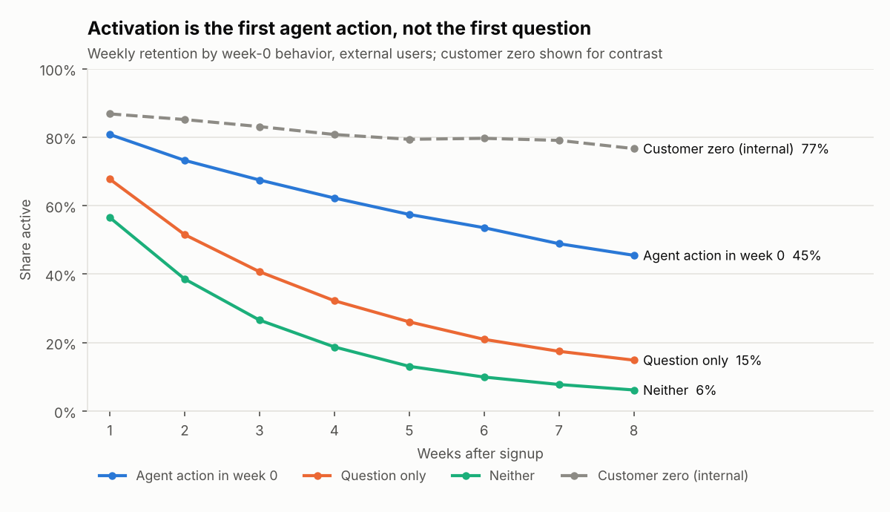
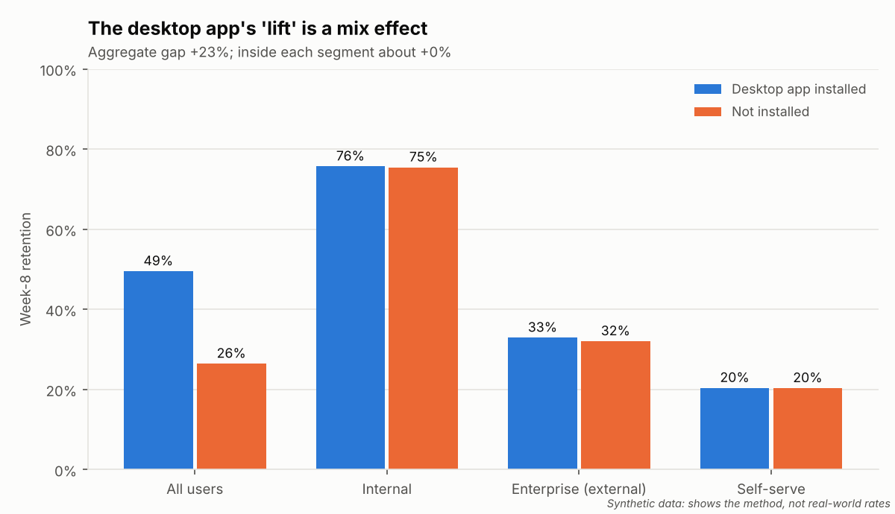
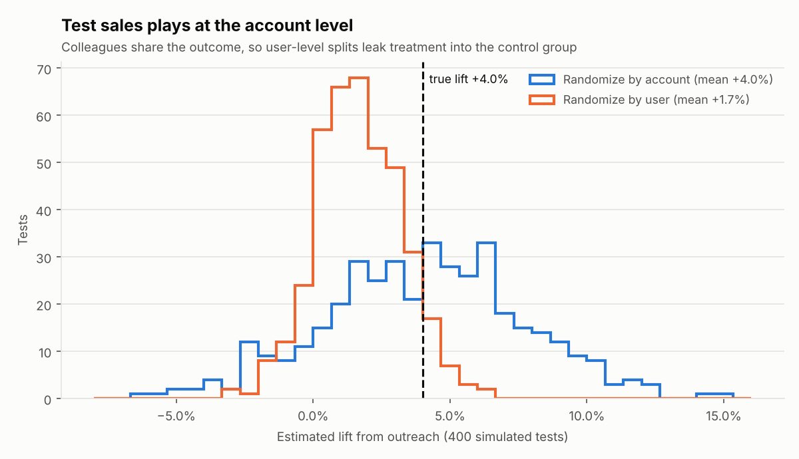
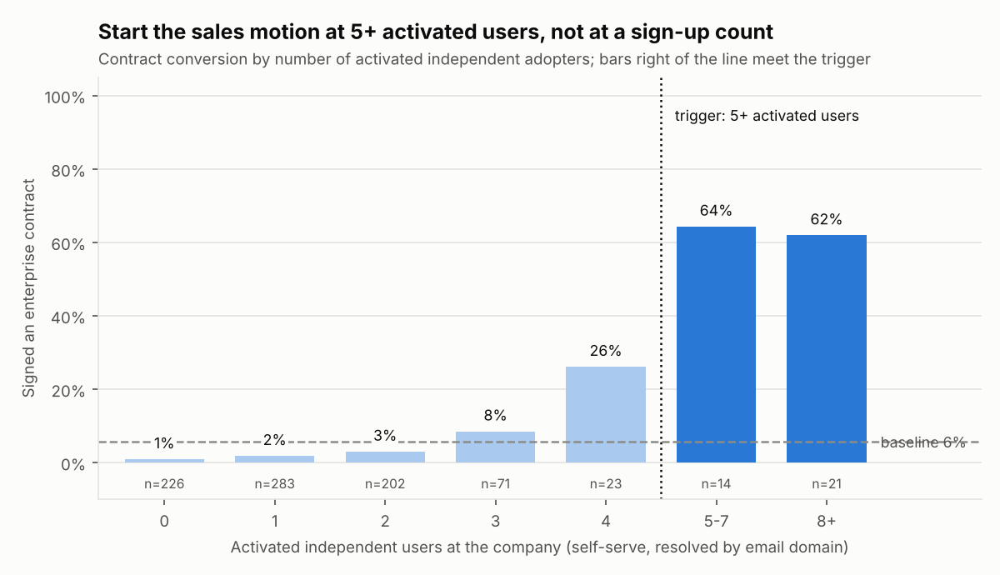

# Sangam: growth signals for an AI workspace product

**Sangam** (Sanskrit: *confluence*) is where independent streams meet and become one river. In product-led growth, the streams are individual adopters who sign up on their own, the colleagues they share with, and the enterprise rollouts that follow. This project finds where they converge.

> **All data is synthetic.** The product modeled is a generic AI workspace (an assistant that answers questions, takes agent actions, shares agents and outputs, and connects to apps), described from public information only. Company names and `.example` domains are invented. Nothing here reflects any company's internal data.

## In 60 seconds

- **Activation is the first agent action.** Users who complete one in their first week retain at 45% at week 8, versus 15% for those who only ask questions.
- **Start an enterprise sales motion at 5+ activated independent users at a company**, not at a sign-up count: those companies convert at 50% versus a 15% baseline. At 4 users, run champion enablement instead.
- **Shared agents are the strongest viral loop; shared assets are the landing loop** that seeds new companies. Embeds and digests barely convert.
- **Pay sharing rewards when the recipient completes a first agent action, and tie them to the account's stage**: same-company shares before a contract, external shares after it. In simulation that keeps the same pipeline gains as uniform rewards while paying 1,340 rewards instead of 12,488.
- **Reward policy is written in plain language.** Teams submit prose guidelines and approve a plain-English card; the framework flags pay-per-share and uncapped schemes, and asks rather than guesses when wording is ambiguous.
- **Visibility is the hidden constraint.** Apple and Amazon sign-ins almost never reveal a company. Connected Slack, Teams and Jira workspaces help, but only with guards: naive matching is 70% accurate and invents sales-ready accounts from school clubs and side projects.
- **Everything is graded**: 38 of 38 checks pass against planted ground truth, including tests of the grader itself.

## Quick start

```bash
pip install -r requirements.txt
python run.py                 # generate data, analyze, grade, write reports/ and this README
python -m evals.run_evals     # grade the analysis against the planted ground truth
```

The agent is optional and needs AWS credentials with Amazon Bedrock model access:

```bash
export AWS_REGION=us-west-2            # optional: SANGAM_MODEL_ID=<bedrock model id>
export AWS_BEARER_TOKEN_BEDROCK=<key>  # or a Bedrock API key instead of an AWS CLI profile
python -m sangam.agent "Which accounts should business development contact this week, and why?"
python -m evals.run_evals --agent      # grade the agent's answers to the golden questions
```

## Findings

Each finding is checked against a planted answer. The [findings memo](reports/findings.md) has the detail.

### 1. Activation is the first agent action, not the first question

External users who complete an agent action in their first week retain at 45% at week 8, versus 15% for question-only users, and the gap holds in every segment. It's observational: high-intent users both act and stay, so the next step is an onboarding experiment that nudges a first agent action.



### 2. Customer zero flatters every headline

A large internal deployment with mandated use lifts week-8 retention from 27% to 33%. External users are always reported separately.

### 3. Breadth predicts retention

Users who link three or more connectors in their first week retain at 49%, versus 19% for one or two.

### 4. Not every lift is real

Desktop-app users retain +18% better in aggregate and about -1% inside every segment. The internal rollout installed the app by default, so the aggregate is a mix effect (Simpson's paradox), and the analysis flags it automatically.



### 5. Test sales plays at the account level

Colleagues share the outcome of outreach. Splitting users inside a company leaks treatment into the control group: in simulation it reports +1.8% against a true lift of +4.0%, while randomizing whole accounts recovers +3.9%.



### 6. Start the sales motion at 5 activated adopters

Learned from 123 observed contracts. Companies with 5+ independent users who completed an agent action convert at 50% versus a 15% baseline (3.4x). At exactly 4 they convert at 24%, a champion-enablement tier; below that, at 4%. The best rule built on raw sign-up counts scores F1 0.42 against 0.55, because event spikes inflate sign-ups without activating.



6 candidate rules are statistically tied (4+ users across 1+ functions, 4+ users across 2+ functions, 4+ users across 3+ functions, 5+ users across 1+ functions, 5+ users across 2+ functions, 5+ users across 3+ functions), so the method bootstraps F1, treats everything within one standard error of the best as a tie, and picks the simplest. A plain "highest F1" search once chose "1+ users across 4+ functions": technically equivalent to 4 users across 4 functions, but nonsense to a seller.

### 7. Rank acquisition channels by pipeline, not volume

Rankings disagree. 'search' brings the most sign-ups, but 'teammate_invite' produces the most sales-ready accounts per 1,000 sign-ups (28.8) and retains 28% at week 8. 'webinar' and 'reddit' retain worst. Invest in invite loops and work-identity channels for pipeline; judge broad social channels on retained users, not sign-ups. Pipeline ranks for 'webinar' rest on fewer than 5 accounts; treat that rank as noise.

| Channel | Sign-ups | Activation | Week-8 retention | Resolved to a company | Sales-ready accounts per 1,000 | Rank: volume / retention / pipeline |
|---|---|---|---|---|---|---|
| teammate_invite | 1,147 | 54% | 28% | 63% | 28.8 | 7 / 1 / 1 |
| linkedin | 1,386 | 46% | 23% | 61% | 26.7 | 2 / 2 / 2 |
| direct | 1,149 | 42% | 20% | 37% | 15.7 | 6 / 3 / 3 |
| search | 1,970 | 42% | 19% | 36% | 10.2 | 1 / 4 / 4 |
| reddit | 1,288 | 32% | 14% | 15% | 8.5 | 4 / 7 / 5 |
| x | 1,311 | 34% | 16% | 19% | 7.6 | 3 / 6 / 6 |
| webinar | 277 | 12% | 0% | 87% | 7.2 | 8 / 8 / 7 |
| youtube | 1,227 | 40% | 17% | 24% | 4.9 | 5 / 5 / 8 |

**Attribution warning.** Viral-loop recipients are 50% of the activated users at sales-ready accounts but get first-touch credit for only 6% of those accounts. First-touch attribution undervalues expansion loops by design, so loops are measured separately, on the prospects they push over the sales trigger.

### 8. Sign-in provider decides who you can see

Provider decides visibility more than quality. 50% of Google and 58% of email sign-ups can be tied to a company, versus 4% for 'amazon' and 9% for 'apple'. 'microsoft' users retain best (23%), consistent with a builder persona. The pipeline ranking mostly mirrors visibility: an account you cannot see never reaches the sales trigger.

| Provider | Sign-ups | Activation | Week-8 retention | Resolved to a company | Private relay | Users at sales-ready accounts per 1,000 | Rank: volume / retention / visibility / pipeline |
|---|---|---|---|---|---|---|---|
| microsoft | 1,392 | 46% | 23% | 61% | 0% | 177.4 | 5 / 1 / 1 / 1 |
| email | 2,674 | 43% | 19% | 58% | 0% | 163.1 | 2 / 5 / 2 / 2 |
| google | 6,149 | 46% | 21% | 50% | 0% | 144.7 | 1 / 3 / 3 / 3 |
| github | 1,581 | 48% | 22% | 30% | 0% | 89.8 | 4 / 2 / 4 / 4 |
| apple | 2,156 | 41% | 19% | 9% | 59% | 25.5 | 3 / 4 / 5 / 5 |
| amazon | 1,045 | 37% | 18% | 4% | 0% | 9.6 | 6 / 6 / 6 / 6 |

1015 self-serve users at prospect companies are invisible today, mostly via apple, github sign-ins. If 30% added a work email, about 18 more companies would cross the sales trigger, on top of 145 visible today; with full visibility, 62 more would. A 'connect your work email to share with your team' prompt is a pipeline lever, not just an identity feature. *(Simulation on synthetic ground truth; real uptake must be measured with an A/B test of the prompt.)*

### 9. Connected workspaces reveal employers, with guards against false positives

People connect their employer's Slack, Teams or Jira, but also their kid's robotics team Slack, hobby groups, big open communities, and clients' workspaces as contractors, and some of those share a company's name.

| Matcher | Users attributed | Precision | Hidden employees recovered | Sales-ready accounts (correct / phantom) |
|---|---|---|---|---|
| Work email only | - | - | - | 145 / 0 |
| Naive connector match | 701 | 70% | 45% | 168 / 9 |
| Guarded connector match | 374 | 100% | 34% | 163 / 0 |

Naive matching attributes 701 hidden users at 70% precision and creates 9 phantom sales-ready accounts. The worst naive error: 'Lumora Makers' put 16 unrelated users into Lumora Retail. Guarded matching attributes 374 at 100% precision, recovers 34% of hidden employees, and adds 18 genuinely sales-ready accounts with 0 phantoms. Trust a workspace's verified domain; treat names as clues that need a colleague to corroborate them; drop guests and any workspace whose members already resolve to several companies. Synthetic data makes the guards look perfect; in production, audit a sample of attributions by hand each quarter.

The guarded matcher trusts verified domains; treats a matching name as a clue that needs a colleague resolved by work email to corroborate it; drops guest memberships; drops workspaces whose connected users already resolve to 3+ companies, the signature of a school club; skips users whose evidence points to two companies; and never overrides a work email. Workspace metadata is personal context: use it only in aggregate at the account level, within the permissions users granted, and never to contact an individual about a side project.

### 10. Viral loops: agent shares grow, asset shares land, rewards must fire on activation

'Shared agent' grows the product most (3.25 activated recipients per 100 users; 56% of its sign-ups activate) and turns fastest. 'Shared asset (URL)' is the landing loop: it seeds the most new companies (49). 'Shared space / knowledge base' recipients retain best. Embeds and digests create many impressions but convert under 3% per share, and referral credits paid on sign-up bring sign-ups of which only 31% activate. In the reward simulation, paying per share sent nearly doubles shares but adds only +269 activated users. The stage-aware policy delivers the same pipeline as uniform weighted rewards (7.3 vs 7.3 extra prospects over the trigger; 3.4 vs 3.4 companies seeded by customers) while paying 1,340 rewards instead of 12,488. Uniform rewards buy more total sign-ups, mostly prosumer activity and colleagues who were already licensed.


| Loop | Shares | Sign-up per share | Sign-ups that activate | Activated recipients per 100 users | Median days to sign-up | Recipient week-8 retention | Companies seeded | Prospects pushed over trigger |
|---|---|---|---|---|---|---|---|---|
| Shared agent | 9,624 | 34.2% | 56% | 3.25 | 2 | 31% | 27 | 46 |
| Shared asset (URL) | 13,402 | 17.2% | 46% | 3.01 | 4 | 24% | 49 | 63 |
| Shared space / knowledge base | 5,443 | 41.0% | 65% | 2.36 | 6 | 34% | 7 | 33 |
| Recurring digest | 13,727 | 2.7% | 38% | 0.36 | 17 | 11% | 5 | 7 |
| Referral credit | 1,218 | 23.9% | 31% | 0.31 | 3 | 12% | 2 | 4 |
| Slack or email embed | 26,169 | 1.6% | 35% | 0.25 | 12 | 15% | 2 | 3 |

**Reward policy simulation.** Eight ways to reward sharing, on the same population:

| Reward fires... | Shares | Extra activated users | Rewards paid | Rewards per extra activated user | Extra prospects over trigger | Extra companies seeded by customers |
|---|---|---|---|---|---|---|
| No reward (status quo) | 69,583 | +0 | 0 | - | 0.0 | 0.0 |
| Per share sent | 125,249 | +269 | 125,249 | 465.61 | 2.2 | 1.2 |
| Per recipient sign-up | 97,416 | +484 | 6,186 | 12.78 | 4.0 | 2.2 |
| Per recipient first agent action | 86,979 | +605 | 12,198 | 20.16 | 5.0 | 2.7 |
| Per first agent action, weighted by share type | 84,977 | +773 | 12,488 | 16.16 | 7.3 | 3.4 |
| Stage-aware, sharer rewarded (see below) | 73,311 | +294 | 1,340 | 4.56 | 7.3 | 3.4 |
| Stage-aware, recipient rewarded | 71,074 | +578 | 1,624 | 2.81 | 13.1 | 6.7 |
| Stage-aware, sharer and recipient rewarded | 73,311 | +803 | 3,698 | 4.61 | 18.8 | 9.3 |

The **stage-aware** policy pays on the recipient's first agent action, weights agent and space shares higher, rewards *same-company* shares before a company has a contract (each activated colleague moves it toward the sales trigger), rewards *external* shares to customers and partners after a contract (customers become a distribution channel), and never pays for colleagues who are already licensed. Paying per share sent nearly doubles shares (125,249) for the smallest gain in activated users.

Viral coefficients are single-generation. The reward simulation rests on stated behavioral assumptions (see BEHAVIOR in sangam/policy.py); test the policy with an A/B test, randomized by workspace, before rolling it out.

### 11. Reward guidelines in plain language

The people who set reward policy (growth, finance, partner teams) write guidelines as ordinary prose and approve a plain-English policy card. They never see a schema. A policy agent compiles the prose; the framework renders it back as a card, flags problems in plain language, and simulates the outcome against the status quo. The compiler never guesses: anything ambiguous becomes a question for the owner, and a policy with open questions can't be simulated or approved.

| Guidelines (prose) | What the policy owner sees |
|---|---|
| [Sharing rewards, Q4](policies/examples/growth_team_q4.md) | No warnings; 1,340 rewards for +294 activated users (4.56 each); ready to approve |
| [Launch blitz](policies/examples/launch_blitz.md) | 5 warnings; 125,249 rewards for +269 activated users (465.61 each) |
| [Partner rewards (draft)](policies/examples/partner_draft.md) | 3 questions to answer; simulation and approval blocked until they are |

The launch-blitz memo ("$10 for every link they share, to anyone ... no limits") comes back with:

> - This pays for sending links, whether or not anyone uses them. People will send links to everyone they know, and recipients will learn to ignore them. Pay when the recipient completes their first agent action instead.
> - This pays when colleagues who already have a license use something shared with them. That usage is already paid for and would mostly happen anyway.
> - This rewards shares to personal email addresses, which anyone can collect by sharing with a second account of their own.
> - There is no limit on how many rewards one person can earn in a month, so a few people can drain the budget.
> - Shares outside the company earn rewards without an admin's approval. Encouraging people to send company work outside the company needs the company's consent.

The partner draft ("reward users when their teammates start using the product in a meaningful way") comes back with questions instead of guesses:

> 1. By "teammates", do you mean colleagues on the same company email domain, or anyone in a shared space, including contractors and guests from other companies?
> 2. What counts as using the product "in a meaningful way": signing up, completing a first agent action, or staying active for several weeks?
> 3. Should shares with partners earn the bonus only once the sharer's company has an enterprise agreement, or at any time? How much larger is the bonus?

<details><summary>The full policy card for the Q4 guidelines</summary>

#### Sharing rewards, Q4

**What earns a reward.** A person earns a reward when the person they shared with completes their first agent action (not when the share is sent, and not at sign-up).

**The reward.** $20 in usage credits.

**Which shares count.** Before their company has a contract, shares to colleagues at their own company count. After their company has a contract, shares to people at other companies (customers, partners, study participants) count.

**Kinds of share.** Every kind of share counts; shared agents and shared spaces and knowledge bases earn more; links embedded in Slack or email and recurring digests earn less.

**Never rewarded.** Shares to people who already have a license.

**Outside the company.** Shares outside the company earn only after a workspace admin approves external sharing.

**Limits.** At most 10 rewards per person per month and a budget of $40,000 a month.

**Filled in where the guidelines were silent** (confirm or correct):
- The guidelines didn't mention shares to personal email addresses; we assumed they don't count.

Compared with offering no reward, this policy would add about 294 activated users, push about 7.3 more prospect companies to the point where a sales conversation makes sense, and help customers bring in about 3.4 new companies. It would pay about 1,340 rewards, or 4.56 per added activated user. This matches the stage-aware reference policy. These figures rest on the growth team's assumptions about how people respond to incentives; confirm them with an A/B test, randomized by workspace, before rolling the policy out.

</details>

```bash
python -m sangam.policy policies/examples/growth_team_q4.md            # card, warnings, expected outcome
python -m sangam.policy policies/examples/growth_team_q4.md --approve  # record approval of the card
```

New guidelines compile live with AWS credentials; the examples also ship with reviewed compilations, so the evals grade the live compiler against them. How people respond to incentives is kept apart from policy: it is the growth team's stated assumption, tested by A/B test, not something a policy author sets.

## How it works

```
sangam/
  generate.py    synthetic users, accounts, events, shares, workspaces; planted effects and noise
  identity.py    resolve self-serve users to companies by email domain
  dhruva.py      the governed metric layer: one definition of "active", "retained", "activated"
  cohorts.py     retention, activation, breadth, Simpson's-paradox check
  pqa.py         product-qualified account scoring, reasons, plays, noise suppression
  motions.py     sales trigger, channel and sign-in provider rankings, work-email what-if
  connectors.py  naive vs guarded identity from connected Slack, Teams and Jira workspaces
  loops.py       viral loop scorecard, expand vs land
  policy.py      reward policy: plain-English card, warnings, simulation, approval
  policy_compiler.py  agent that compiles prose guidelines; asks instead of guessing
  experiment.py  outreach holdout simulation: account vs user randomization
  tools.py       the functions the agent may call (testable without a model)
  agent.py       Strands agent on Amazon Bedrock
  report.py      charts and findings memo;  readme.py renders this README from the results
evals/
  golden.json    golden questions with required facts, caveats and forbidden claims
  run_evals.py   grades the analysis, the reward-guidelines pipeline, the rubric itself,
                 and (optionally) the live agent and policy compiler
policies/examples/  sample guidelines: sound, sloppy and ambiguous
```

**Dhruva, the metric layer.** Named for the pole star you navigate by. Every number, in a chart or in an agent's answer, comes from one set of definitions.

**An agent you can check.** The agent can only call governed tools. Its instructions require sample sizes, external-only reporting, a within-segment check before crediting any feature, a named alternative explanation, and a confirming experiment. The eval rubric scores each answer on required facts, required caveats and forbidden claims, and the rubric is itself tested: a known-good answer must pass and a known-bad one must fail. That self-test once caught the grader reading "5 activated users" as "5%" and failing a correct answer.

## Eval results

```
[analytics]
  PASS  Customer zero inflation detected
  PASS  Agent action beats question-only for activation
  PASS  3+ connectors retain better than 0-2
  PASS  Desktop app flagged as confounded (Simpson's trap)
  PASS  PQA precision@30 >= 0.8
  PASS  No webinar-noise account in the top 30
  PASS  All webinar spikes flagged, no false flags
  PASS  Account-level design recovers true lift (within 1.5 pts)
  PASS  User-level design underestimates (interference)
  PASS  Sales trigger recovers the planted tipping point (5 activated users)
  PASS  Activated-user trigger beats a sign-up-count trigger
  PASS  Teammate invites retain best; invites and LinkedIn lead on pipeline
  PASS  Low-intent social channels rank in the bottom half on retention
  PASS  Work identities (Google, Microsoft, email) are the most visible providers; Apple and Amazon the least
  PASS  Making hidden adopters visible adds sales-ready accounts
  PASS  Naive connector matching produces false positives
  PASS  Guarded connector matching is precise and adds real sales-ready accounts
  PASS  Community and side-project workspaces are the main false-positive source
  PASS  Shared agents have the highest viral coefficient on activated users
  PASS  Shared spaces retain recipients best
  PASS  Shared assets seed the most new companies
  PASS  Embeds and digests convert worst per share
  PASS  Referral sign-ups activate least
  PASS  Rewarding shares sent maximizes shares but not activated users
  PASS  Stage-aware rewards keep the pipeline gains at a fraction of the cost
[policy]
  PASS  Sound guidelines: no warnings, and activation gains at a low reward cost
  PASS  Sloppy guidelines: every planted problem is flagged in plain language
  PASS  Ambiguous guidelines: questions raised, simulation and approval blocked
  PASS  Cards and warnings contain no field names or code
  PASS  Card states what the guidelines said
  PASS  Compile grader passes reviewed compilations and catches planted mistakes
[rubric_self_test]
  PASS  Rubric separates good from bad answer: activation-definition
  PASS  Rubric separates good from bad answer: headline-retention
  PASS  Rubric separates good from bad answer: desktop-app
  PASS  Rubric separates good from bad answer: sales-targets
  PASS  Rubric separates good from bad answer: sales-trigger
  PASS  Rubric separates good from bad answer: connector-identity
  PASS  Rubric separates good from bad answer: reward-policy
38/38 checks passed
```

## Limits

- Planted effects are deliberately clear; real data is noisier. Thresholds are starting points to tune against real outcomes.
- The sales trigger is fit on 123 contracts, so several rules tie; refit it as contracts accumulate and by segment.
- Activation and channel findings are observational. Only experiments settle cause.
- The reward simulation rests on stated behavioral assumptions (`BEHAVIOR` in `sangam/policy.py`); its value is the measurement design. Viral coefficients are single-generation.
- Using a personal sign-up's activity or workspace metadata to prompt outreach must respect the permissions users granted and regional law. Individuals get in-product nudges, not sales calls.

## License

MIT. Built by Rahul Kamath.
