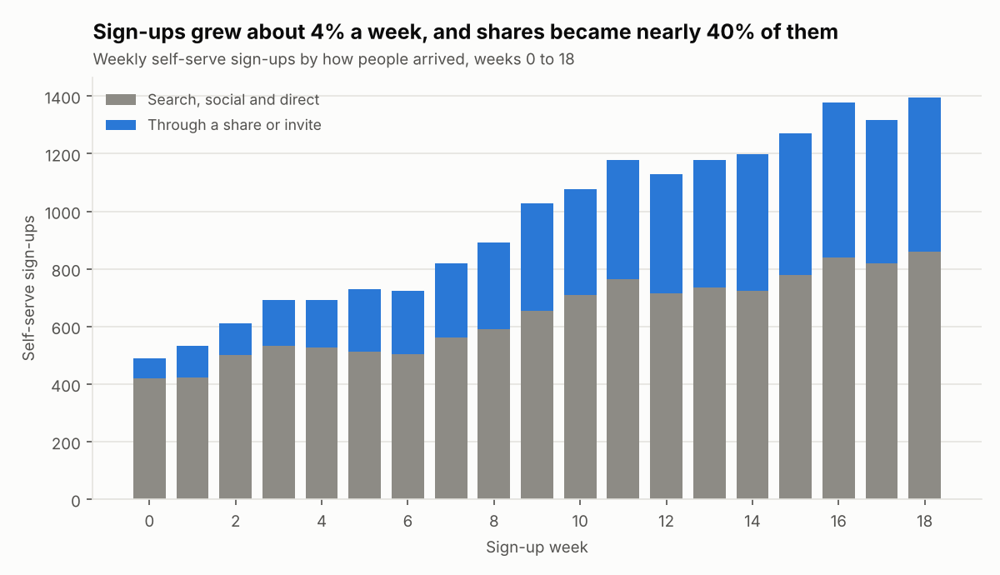
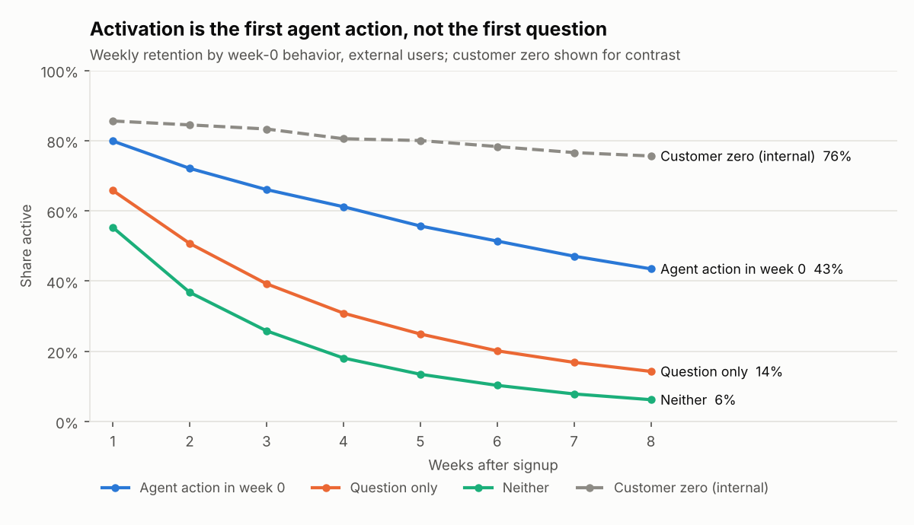
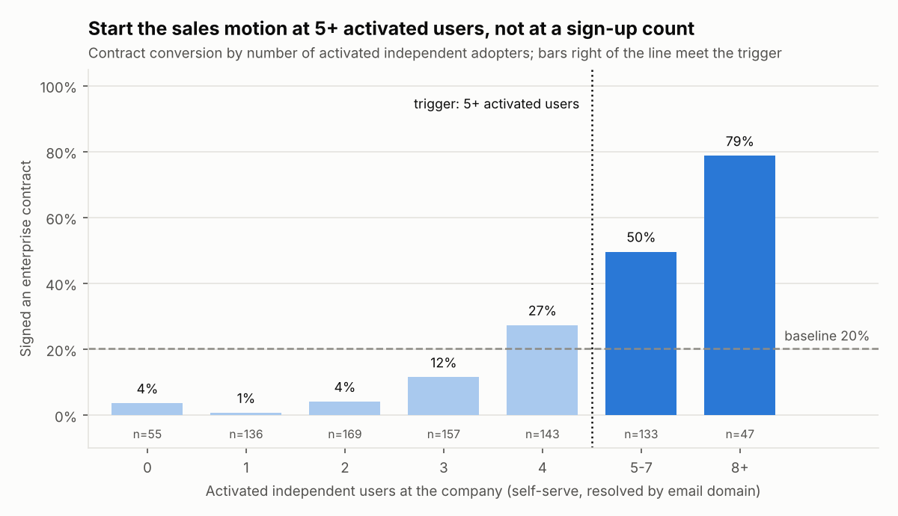
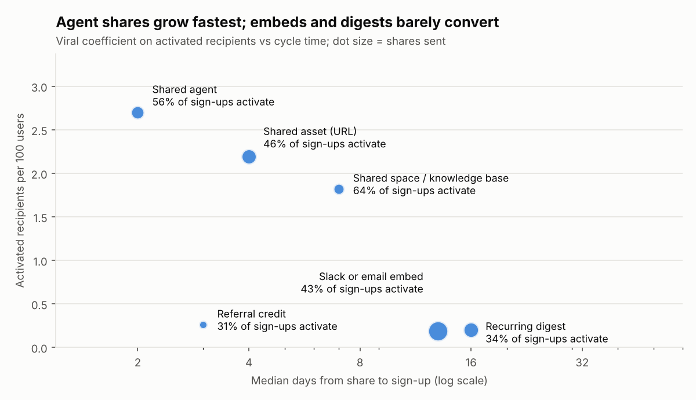
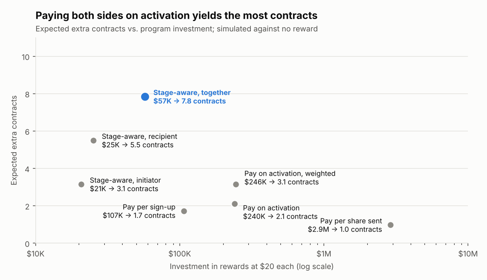

# A Sign-up Isn't a Signal

*A growth strategy for a freemium AI workspace, from first sign-up to an enterprise that builds its own context into the product, tested where it can be on synthetic data.*

Rahul Kamath · Published on [Substack](https://rrkamath.substack.com/p/a-sign-up-isnt-a-signal)

## Summary

A freemium AI workspace does not win an enterprise when people sign up. It wins when colleagues get the product to do real work, when their company decides to deploy it, and when that company starts building its own context into it. This paper sets out a growth strategy for that whole path and tests the first half of it on a synthetic workspace of 35,017 users across 900 companies over 19 weeks. We generated the data to enable the cohort analysis and to prove the methodology before it meets real customers.

### What the experiment showed

- **Activation is an action, not a sign-up.** Users whose first week included an agent action were still active at week 8 at 43%, against 14% for users who only asked questions.
- **Five activated colleagues make a company ready to buy.** Companies with five or more bought at 57%, against a 20% baseline; at four, 27%; below that, 5%. A rule built on sign-up counts picked buyers at only 38%.
- **Sharing amplifies growth but does not sustain it.** Every 100 activated users brought about 17 more. The median company took 10 weeks to go from its first activated user to its fifth, and 54% of those later colleagues arrived through a share or invite.
- **Rewards pay when they buy outcomes, by stage.** Rewarding both sides of a share when the recipient completes a first agent action, among colleagues before a contract and with outside contacts after, yielded an expected 8 contracts for about $57,000 in credits. Paying for every share sent cost $2.9 million and yielded about one.
- **You cannot grow an account you cannot see.** Work sign-ins tie about half of users to a company; consumer sign-ins, under a tenth.

### The strategy that follows

Growth is managed as a lifecycle with gates, not a sign-up funnel. The early gates, from first agent action to five activated colleagues to a contract, are measured here. The later gates, where a company connects its systems with approval, brings in its content, curates context, builds indexes and custom agents, and improves answers through feedback, are where an AI workspace becomes hard to replace. They are designed here and must be proven in market. Growth stays within each company's rules: no reward pays for moving company work outside without consent, and the point where five colleagues are active is the point where IT is brought in.

### How it should be run

Every claim is a hypothesis with a metric and a decision rule set before the data is read. Every program ships behind a test randomized by company, with a holdout and guardrails. One metric layer defines every number, and automated checks grade both the analysis and the grader. The code is open: github.com/rkamath2001/plg-growth-signals.

## 1. The outcome we built for

Every growth program needs one number to steer by. Here it is Dhruva, named for the pole star in Indian tradition: weekly agent-active users, external users only. It counts people who got the product to do work in a given week, not people who merely logged in. Internal use is mandated and flatters every headline, so the customer-zero deployment, 3,500 users at the company that builds the product, is removed before any metric is computed.

Dhruva is also the project's metric layer: one definition each of active, retained and activated, so every chart, every analysis and the AI agent that answers questions about the data report the same number. It converts every program into one comparable unit. An activated user is agent-active in about half of the weeks that follow, while a user who only asks questions is agent-active in 11%, so each program is judged by its lift to the north star and its yield in contracts, against what it cost.

The north star should mature with the customer. Weekly agent-active users is the right measure while companies are adopting. Once a company has deployed, the better measure is weekly agent actions grounded in that company's own context, because that is the usage a competitor cannot easily take away.

## 2. How the experiment was designed

### Synthetic data to prove the method

Customer data cannot be used in a public study, so we generated a synthetic AI workspace, built from public information only, to enable the cohort analysis and prove the methodology. It models 35,017 users across 900 companies over 19 weeks, plus one internal customer-zero deployment. Self-serve sign-ups grow about 4% a week, and enterprise pilots start throughout the period. Of 840 prospect companies, 170 went on to sign a contract. The data includes the situations that commonly mislead growth teams: a feature lift that is really a mix effect, employer clues that are really a school robotics club, and companies whose sign-ups spike in a single webinar week. The project is called Sangam, Sanskrit for confluence, where independent streams meet and become one river, as individual adopters converge into an enterprise account.

### How the cohorts were organized

Each cohort answers a different strategic question:

- **Time cohorts,** users grouped by sign-up week (weeks 0 to 18), show whether the product and onboarding are improving. In a real product, rising cohort curves are the evidence that onboarding work pays off.
- **Behavior cohorts,** users grouped by what they did in their first week (an agent action, only questions, or neither) and by how many apps they connected, show which early behaviors predict lasting use and therefore what activation should mean.
- **Company cohorts,** companies grouped by how many activated users they have and by the week their first user arrived, show when individual adoption becomes an account and how long that takes.
- **Share cohorts,** shares grouped by what was shared, who received it and the account's stage, show which loops spread the product and which ones are worth paying for.
- **Identity and audience cohorts,** users grouped by sign-in provider and by whether they are prosumers on a personal identity, prosumers on a work identity, or employees under a contract, show who can be tied to a company and how each audience should be served.

Any cohort under 150 users is reported but flagged as too small to act on.

### Why week 8

Retention is measured at week 8 after each user's own sign-up, for three reasons.

First, week 8 is predictive. Among users who could be followed for 12 weeks, 54% of those active at week 8 were still active at week 12, against 2% of those who were not. A user's week-8 status is a strong early read on whether they stay.

Second, a longer window costs too much evidence. With 19 weeks of data, 9,466 self-serve users, about half, signed up early enough to be followed to week 8. Only 5,291 could be followed to week 12, and every cohort that arrived after week 6 would drop out of the measure.

Third, it fits the speed of account formation. The median company took 10 weeks to go from its first activated user to its fifth, so a week-8 reading on early adopters arrives while the account is still forming and can still change how it is worked.

Week 8 is a checkpoint, not a plateau. Retention was 67% at week 1, 37% at week 4, 20% at week 8 and 12% at week 12, still declining. On real data, the window should be set where the retention curve flattens, and the choice revisited as the product changes.

### Hypotheses set in advance

Each hypothesis was fixed before any analysis ran:

- A first-week agent action predicts retention better than asking questions. Supported: 43% versus 14% at week 8.
- Connecting more apps early predicts retention. Supported: 48% for three or more, 19% for one or two, 13% for none.
- The internal deployment inflates headline retention. Supported: 34% with it, 26% without.
- Desktop-app users retain better. Rejected: the 23-point lift disappears inside every user segment.
- Activated users per company predict contracts better than sign-ups. Supported: a five-user trigger converts at 57%, a sign-up rule at 38%.
- Shares that show the product working spread it best. Supported: shared agents and documents lead; embeds and digests convert under 2% per share.
- Paying on the recipient's first agent action, by stage, beats paying per share. Simulated only; it rests on stated assumptions and is the first thing to test.

## 3. What the experiment showed

### The funnel as it stands

Of 18,334 self-serve sign-ups, 42% completed an agent action in their first week. Counting from each user's own sign-up, 67% were active one week later, 37% four weeks later and 20% eight weeks later. 39% could be tied to a company, and 7% upgraded to a paid individual plan. Of 840 prospect companies, 785 had at least one activated user, 323 reached four and 180 reached five. Of the 170 contracts, 103 came from those 180 companies.

Weekly sign-ups grew from about 490 to about 1,350, and the share arriving through a share or invite rose from 14% in week 0 to nearly 40% by week 14. Weekly active users grew from 633 to about 10,900 by week 18, and the north star from 306 to 7,433. Each weekly cohort activated at 39 to 45% and retained 19 to 23% at week 8: steady, because the synthetic product does not change over time.

### Activation is an action

Users who completed an agent action in their first week retained at 43% at week 8 (7,483 users), against 14% for those who only asked questions (7,835 users), and were active in 4.9 of their first 8 weeks against 2.9. Breadth matters too: users who connected three or more apps in their first week retained at 48%. Both findings are observational, since high-intent users both act and stay; the onboarding test in section 7 separates cause from correlation.

### Headlines mislead unless they are controlled

Customer zero lifts week-8 retention from 26% to 34%. Desktop-app users retained 23 points better overall, which would justify a campaign to promote the app, yet inside every segment the difference was about zero, because the internal deployment had installed the app by default and also retains well. This is Simpson's paradox: a pattern across a whole population that disappears inside every subgroup because the subgroups differ in size and behavior. The analysis now checks every feature lift within segments before anyone acts on it.

### Five activated colleagues make an account

Companies with five or more activated users bought at 57%, 2.8 times the 20% baseline. At exactly four, 27% bought; below four, 5%. The implication is a division of labor: below four, leave the company to self-serve; at four, help the internal champion bring in the fifth colleague; at five, begin the enterprise conversation. The best rule based on raw sign-ups flagged 321 companies, and only 38% of them bought, because it flagged all 12 companies whose sign-ups arrived in a single webinar week with little activation.

### Accounts form over a quarter, through sharing

The median company took 10 weeks to go from its first activated user to its fifth, and the middle half took 8 to 13 weeks. 54% of the colleagues who joined after the first arrived through a share or invite, against 44% at companies that never reached five. Sharing is an amplifier rather than an engine: 82% of activated users shared something, yet every 100 activated users brought about 17 more, well below the 100 needed for sharing to sustain growth alone. What is shared matters. Shared agents converted fastest, with 56% of their sign-ups activating; shared documents were the first touch at 60 companies that had no users before; shared spaces kept recipients best, at 42% retained at week 8.

### Visibility is the hidden constraint

An adopter who cannot be tied to a company never counts toward one. Sign-ins through Microsoft work accounts, work email and Google tie 49 to 58% of users to a company; Apple and Amazon tie 4 to 7%. These rates follow from how the synthetic data models each sign-in method, so real rates must be measured on real sign-ups. In the data, 1,034 employees of prospect companies are hidden behind personal sign-ins. If 30% of them added a work email, about 25 more companies would cross the trigger. Matching the Slack, Teams and Jira workspaces users connect recovers more, but only with guards: naive matching invented adopters at 9 companies, while the guarded matcher, which rejects guests, open communities and ambiguous names, was right every time and added 37 sales-ready companies.

### Three audiences, served differently

The same person can be a prosumer and an employee. Prosumers on a personal identity (11,210 users) upgraded to a paid plan at 6.8%, and 11% of them actually work at a company in the data. Prosumers on a work identity (7,124) upgraded at 7.2% and count toward their company's trigger. Employees under a contract (13,183) retained best, at 32%, and become a distribution channel to their own customers and partners: their shares to other companies activated 34 recipients per 1,000 shares. Sharing among colleagues who are already licensed adds no users, as 26,845 such shares produced no sign-ups.

## 4. How we thought about rewards

Rewards are an investment, so they were designed from four principles and judged by their yield on the north star and in contracts.

**Pay for outcomes, not activity.** A share costs nothing to send and a sign-up can be a favor. The reward is paid when the recipient completes a first agent action, the event that predicts retention.

**Pay by stage.** Before a contract, only shares to colleagues at the same company count, because each activated colleague moves the company toward five. After a contract, only shares to people at other companies count, because colleagues are already licensed and customers become a channel. This rule cut the reward bill by about 90% while keeping the same pipeline.

**Choose who is rewarded deliberately.** The study compared rewarding the initiator, the recipient and both. Rewarding the recipient was the cheapest way to buy contracts, about $4,600 each for 5.5 expected contracts; rewarding both bought the most, 7.8 expected contracts and about 310 more weekly agent-active users for $57,380. Paying for every share sent cost $2.9 million for about one contract. Which side to reward rests on assumptions about how people respond to incentives, so it is the first thing to test.

**Credit sharing beyond first touch.** People who arrived through a share make up 36% of activated users at sales-ready companies, yet first-touch attribution credits sharing with only 8% of those companies. A team that budgets by first touch underfunds its best expansion channel.

The people who set reward policy write it in prose, not configuration files, so the framework evaluates their guidelines before launch. An agent compiles the prose into a policy; anything ambiguous becomes a question for the owner rather than a guess; problems are flagged in plain words; and the policy is simulated against offering no reward before a person approves it. A launch memo offering "$10 for every link they share, to anyone, no limits" came back with five warnings. A partner draft that rewarded "teammates" for "meaningful use" came back with three questions and could not be approved until someone answered them.

## 5. Responsible growth: connections, content, context and contribution

A workspace that grows from the bottom up reaches people before their company has approved it. The tempting shortcut is to let each person connect company email, files and chat on their own. Many acceptable-use policies forbid this, many companies can block it through their sign-in controls, and a vendor that profits from it erodes the trust an enterprise relationship depends on. The strategy therefore treats growth within company rules as a design requirement. The first principle below is built into the framework; the rest are design choices this study does not test, because the synthetic data does not model what content users bring, whether their company permits it, or how admins respond.

### Secure connections for onboarding

Rewards never pay for moving company work outside the company without consent. Before a contract, the stage-aware programs pay only for shares to colleagues; shares outside the company earn only after a workspace admin approves external sharing, which is the default when guidelines are silent, and a policy that drops it is flagged before launch. Shares to personal email addresses are not a reward channel. Identity resolution ties users to their employer so that the company can see and govern adoption early, not to work around it. When five colleagues are active, the next step is an admin trial and an approved connection to company systems.

### Content onboarding

The first experience must deliver value without company data: public research, content the user is plainly entitled to use, and apps the company has already approved. Company content enters through connectors an admin approves, at the company level, with the company's permissions carried through. The hard product problem in this lifecycle is proving value before any company data exists, and it deserves its own experiments.

### Context curation

Content becomes useful to agents only when someone gives it meaning. Curating a space for a topic, describing datasets and fields so a term means the same thing in every answer, scoping a custom agent's instructions and knowledge, and encoding a team's procedure as a reusable workflow are the actions that build a company's context. They compound: one person's curated space improves every colleague's answers.

### Collaborative contribution and consumption

A healthy account has both contributors and consumers. The measure of contribution is reuse rather than creation, for the same reason rewards pay on activation rather than on shares: counting spaces created or descriptions written breeds empty ones. Two numbers show whether a company is building a shared context: the share of active users who contribute, and the agent actions by other people that draw on contributed context. If contribution is rewarded, it is rewarded on reuse by others.

## 6. The lifecycle funnel and the gates we would add

The funnel measured in this study runs from a sign-up to a contract. For an AI workspace, the contract is the midpoint. The lifecycle continues as a company connects, curates and builds, and each stage needs a gate: a defined event that marks passage, a metric, and an owner.

### The gates measured today

1. **Sign-up.** A person creates an account. Measured by sign-ups by channel and the share tied to a company.
2. **Activation.** The first agent action, in the first week. Measured by the activation rate by cohort.
3. **Habit.** Active at week 8 after sign-up. Measured by week-8 retention by cohort.
4. **Team formation.** Five activated colleagues at one company. Measured by companies at four and at five, and weeks from the first activated user to the fifth.
5. **Contract.** The company buys. Measured by conversion from the trigger, against a holdout.

### The gates we would add

6. **Secure connection.** An admin takes ownership of the workspace, turns on single sign-on and approves the first connector to a company system. Measured by weeks from contract to first approved connector. Owned by the account team with the customer's IT.
7. **Content ingested.** Approved company content is brought in with its permissions. Measured by the share of deployed companies with content from at least one company system.
8. **Context curated.** Spaces, definitions and descriptions exist for the company's important topics. Measured by the share of active users who contribute context.
9. **Indexes built.** Company content is indexed and grounds agent answers. Measured by the share of agent actions grounded in company content.
10. **Custom agents built.** Teams build agents and workflows scoped to their own work. Measured by custom agents with active users beyond their author.
11. **Shared and consumed.** Context and agents are reused across the company. Measured by agent actions by others that draw on contributed context.
12. **Human-in-the-loop feedback.** People confirm, correct and improve answers, and the corrections improve later answers. Measured by the share of agent actions reviewed and the rate at which corrected answers stop recurring.

Gates 6 to 12 are hypotheses. The expectation is that they predict renewal and expansion better than seat counts, and the first job of the instrumentation is to test that. They also change who acts: individuals pass the early gates on their own, while the later gates need admins, curators and teams, so the growth motion shifts from individual incentives to account programs.

## 7. Experiments we would run, by signpost

Each test begins from a signpost, the observed state that makes the test worth running, and states the hypothesis, the design and the decision rule. Tests on sharing, onboarding for work sign-ups and sales outreach are randomized by company, because colleagues talk and a test inside one company leaks. In the simulated outreach test, splitting users inside each company estimated less than half the true effect.

1. **Reward programs.** Signpost: a company without a contract where colleagues are sharing. Hypothesis: rewarding the recipient's first agent action, or both sides, raises activated recipients per share at acceptable cost. Design: no reward against initiator, recipient and two-sided rewards, all stage-aware. Primary metric: activated recipients per 1,000 shares; secondary: companies reaching five. Guardrails: cost per activated user and self-referral. About 8,500 same-company shares per arm detect a rise from 4.8% to 5.8%.
2. **Onboarding to a first agent action.** Signpost: a new user in their first week. Hypothesis: steering users to an agent action raises week-8 retention, not only activation. Primary metric: week-8 retention and the north star. About 2,900 users per arm detect a rise from 20% to 23%.
3. **First value without company data.** Signpost: a new user whose company has no approved connectors. Hypothesis: ready-to-run agents on public and user-owned content activate as well as connected ones. Primary metric: first-week agent actions and week-8 retention. Guardrail: attempts to connect unapproved company systems.
4. **The work-email prompt.** Signpost: an active user on a personal sign-in. Hypothesis: framed as sharing with one's team, the prompt reveals hidden employees. Primary metric: share who add a work email, and companies newly reaching five. Guardrail: drop-off at the prompt. About 700 users per arm detect a rise from 10% to 15%.
5. **The team-progress view.** Signpost: a company at four activated users. Hypothesis: helping the champion bring in the fifth colleague causes contracts rather than merely predicting them. Primary metric: the share reaching five within eight weeks; secondary: contracts.
6. **Admin onboarding at the trigger.** Signpost: a company at five. Hypothesis: an admin trial with a guided, approved first connection shortens time to contract and to the secure-connection gate. Primary metric: weeks to first approved connector. Sales outreach is measured the same way, against a company-level holdout; because contracts are rare, detecting a 4-point lift needs over 2,000 companies per arm, so a leading metric such as qualified meetings within 60 days is used and results are pooled across quarters.
7. **Contribution rewarded on reuse.** Signpost: a deployed company where few users contribute context. Hypothesis: recognizing contributors when colleagues reuse their spaces or agents raises the contributor share without inflating empty artifacts. Primary metric: agent actions by others grounded in contributed context. Guardrail: contributions never reused.
8. **Feedback prompts.** Signpost: a custom agent with growing use. Hypothesis: asking users to confirm or correct answers at the right moment raises answer quality without slowing work. Primary metric: recurrence of corrected errors. Guardrail: task completion time.

Two findings need no test. The desktop app's lift is a mix effect, so promoting it would not move retention. The contract trigger needs monitoring rather than an experiment: it is refit each quarter as contracts accumulate.

## 8. Control and monitoring built into the process

Control means every number is defined once, every program has a counterfactual, and every result is checked before anyone acts on it. Monitoring means the same measures are read on a fixed cadence, so a change in behavior is caught in weeks rather than quarters.

### What must be measured

- **User acquisition:** sign-ups by channel and sign-in provider, the share tied to a company, the share arriving through shares or invites, and cost per activated user by channel.
- **Enterprise acquisition:** companies at each gate, weeks between gates, conversion from the trigger against the holdout, and the hidden employees at prospect companies.
- **Cohort behavior:** activation and week-8 retention by sign-up week, first-week behavior, audience and company cohort, with late cohorts marked as incomplete rather than inactive.
- **Engagement:** the north star, agent actions per agent-active user, weeks active out of the first eight, and, after deployment, the share of agent actions grounded in company context.
- **Context and contribution:** contributor share, reuse of contributed context, custom agents used beyond their author, and the rate of reviewed and corrected answers.
- **Rewards and economics:** cost per activated user, per company reaching five and per expected contract, with caps and self-referral monitored.
- **Responsible growth:** shares outside companies without admin approval, connection attempts to unapproved systems, and admin opt-outs. Any rise is a stop signal, not a trade-off.

### The controls

- **One metric layer.** Dhruva defines active, retained, activated and the north star once, for every chart, analysis and agent.
- **External users only.** Internal and mandated use is excluded from every headline.
- **Automatic within-segment checks.** No feature lift is reported until it holds inside each segment.
- **Small-sample and censoring flags.** Cohorts under 150 users are flagged, and weeks beyond the observation window are treated as unknown.
- **Standing holdouts.** A company-level holdout for rewards and sales outreach, so the counterfactual is always current.
- **Guardrails with stop rules.** Each test names the guardrails that end it early.
- **Policies checked before launch.** Reward guidelines are compiled, linted and simulated before a person approves them.
- **Evals that grade the analysis and the grader.** 40 automated checks that the analysis reaches the expected results, plus a self-test proving the rubric fails a bad answer.

### The cadence

The north star and guardrails are read weekly. Cohorts and gate conversion are reviewed monthly. The contract trigger, the week-8 window and the reward assumptions are refit quarterly.

## 9. A culture of hypothesis testing

The approach rests on one discipline: state the hypothesis, the metric and the decision rule before the data is read; run the smallest test that can answer it; measure against a counterfactual; and iterate on what was learned. Observational findings earn a test, not a launch.

The study held itself to the same standard. Every hypothesis was fixed before analysis, and automated checks graded the results. When the synthetic data was regenerated with sign-ups continuing through the full period, a promising finding about champions who share early shrank from 20% against 13% to 24% against 19%, so it was withdrawn as a claim and became the team-progress test. When the generator itself proved flawed, with sign-ups stopping early and creating a false cliff in the north star, the flaw was fixed, the analysis rerun and the loosened eval thresholds disclosed. Rapid iteration only works when results that do not replicate are dropped as quickly as results that do are adopted.

## 10. Built to be reused, and its limits

The project is designed so a growth team can apply it to its own questions: a synthetic data generator, where every effect and source of noise is a setting; Dhruva, the metric layer; the funnel, cohort, identity, expansion, viral-loop and reward analyses packaged as tools; an agent restricted to those tools, which must quote sample sizes, report external users separately, check lifts within segments and name the experiment that would confirm its answer; reward guidelines in plain language, evaluated before launch; and evals that grade the work and the grader. The README is generated from the results, so the documentation cannot drift from the numbers. Everything is open source under the MIT license and runs offline on a laptop in under a minute: github.com/rkamath2001/plg-growth-signals.

**Limits.** The data is synthetic, and its effects are cleaner than real ones. The contract trigger is learned from 170 contracts, so neighboring rules are statistically close and the rule should be refit as contracts accumulate. The reward results rest on stated assumptions about how people respond to incentives; they are a design for a test, not a forecast. The data holds no contract values or dates, so revenue and time to close need real pipeline data. Gates 6 to 12 and the responsible-growth principles beyond reward eligibility are designs, not findings.
